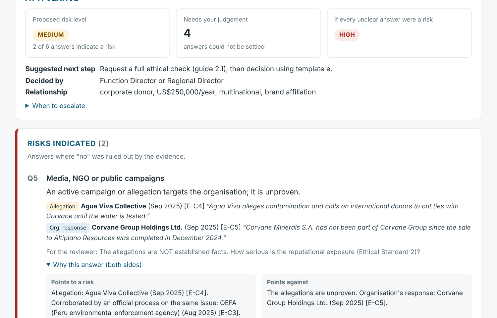
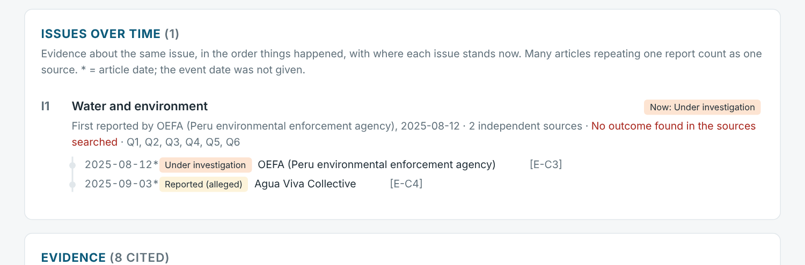
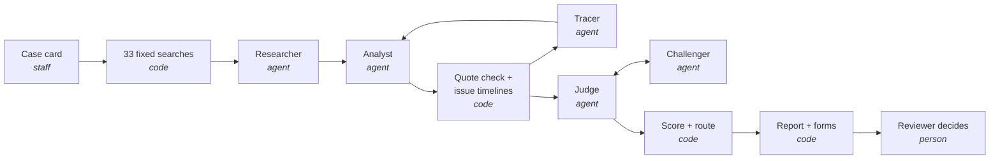

# Ethical Due-Diligence Agent

**A multi-agent AI system that researches a company on the live web and drafts an evidence-backed ethical
risk assessment, with every claim traced to a quoted source and a person making the final decision.**

Built for **The Water Challenge** hackathon (challenge A5, *Due Diligence Agent for Ethical Partnerships*, a WaterAid brief).




---

## The problem

Before a charity accepts money or a partnership from a company, a member of staff must check that the
company's record won't harm the charity's mission or reputation. Done by hand, that means:

- **33 web searches** per company ("bribery", "pollution", "investigation"…), scanning the first pages of each;
- answering **six fixed questions** (e.g. *investigated in the last 10 years? harming communities' water access?*);
- counting the "yes" answers into a **low / medium / high** risk level that decides who signs off.

It takes **one to two hours per company**, and the result depends on who does it.

## What this project does

Give it a company's name. It returns a review-ready assessment in minutes:

- **Researches the live web** and follows leads to primary sources: regulator notices, court records, filings.
- **Reads every source**, including long PDFs, and labels each item as an *allegation*, *investigation*,
  *finding* or *company response*, with an exact quote.
- **Builds a timeline per issue**: when it started, who reported it first, and where it stands now.
- **Answers the six questions from both sides**. A second agent then challenges each answer.
- **Scores with the charity's own fixed rule** and fills its assessment forms (HTML, PDF, Word, CSV).
- **Shows what it doesn't know**: "unclear" answers come with the question that would settle them.



---

## How it works

Five AI agents work inside a fixed, auditable pipeline. The AI handles judgement: where to look, how to read,
how to argue a call. Code handles everything that must be the same every time. A person decides.



| Agent | Role | Tools | Guard rails (enforced in code) |
|---|---|---|---|
| **Researcher** | Decides what to search and read beyond the fixed searches; follows leads to primary sources | `web_search` (incl. last-12-months filter), `open_page`, `search_found_pages`, `finish` | May only open URLs it was shown; budgets for searches, pages and turns; every action logged with its reason |
| **Analyst** | Labels each issue in a source: status, exact quote, event date, issue name | One source at a time, in parallel; long documents reduced to relevant passages | Quote must appear word for word in the source; the code decides who a source is about |
| **Tracer** | For serious issues with an open end: back to the original record, forward to the outcome | Same as the researcher | Reports "no outcome found" rather than guessing |
| **Judge** | Answers the six questions, building the case for and against each answer | Evidence + issue timelines | Can only cite evidence that exists |
| **Challenger** | Argues for a different answer; the judge must hold with a rebuttal or change its call | Same evidence | Both sides shown to the reviewer |

**Retrieval** happens at two levels (agentic RAG): the agents decide which *documents* to fetch from the web,
then a per-case BM25 index finds the relevant *passages* inside them, so an issue on page 80 of a report
isn't missed.

## Key design decisions

| Decision | Why |
|---|---|
| **Fixed workflow with agents inside**, not free-roaming agents | Due diligence needs the same coverage every time and an audit trail. Autonomy is used only where it pays off |
| **Scoring is never AI** | The same answers must always give the same risk level. A model can't move a partner from medium to low |
| **Every quote verified against its source** | Removes the most damaging failure: a confident claim with an invented source |
| **"Unclear" is a first-class answer** | Doubt becomes a specific question for staff, not a false yes or no. A worst-case level shows how much rides on it |
| **Evidence graded by status**, not by sentiment | One fine outweighs any amount of positive press. An allegation is never presented as a fact |
| **Issues tracked over time** | A 2019 allegation later dismissed is not a current risk. Twenty articles repeating one report count as one source |
| **A rule-based baseline** of the same pipeline | Runs free and deterministically. It's the reference the AI is tested against |
| **Swappable components** behind interfaces | Search engine, LLM provider and each agent change in config, not code |

---

## Evaluation

An agent does a chain of jobs (search, read, label, answer), so it's evaluated against **ground truth at each
step**, not just the final answer. Expected results were written by hand *before* running the tool.

| What is measured | Ground truth | Metric |
|---|---|---|
| Final answers | Correct call for each question, risk level, worst case | Accuracy |
| Research coverage | Sources the research must reach, including pages reachable **only by following a link** | Retrieval recall |
| Evidence labels | Correct status for key sources (allegation, investigation, finding, response) | Label accuracy |
| Issue timelines | Current status of key issues | Accuracy |
| Faithfulness | Every quote must appear in its source | Checked automatically on every run |
| Each agent's contribution | The same cases with one agent switched off | Ablation |
| Run-to-run stability | Repeated AI runs on the same input | Consistency (share of identical calls) |

**Current results** on three hand-built test companies (clean, medium risk, ambiguous):

| Set-up | Checks passed | Call accuracy | Retrieval recall | Label accuracy |
|---|---|---|---|---|
| Full pipeline (rule-based baseline) | **33 / 33** | 100% | 100% | 100% |
| Same, **without follow-up research** | 26 / 33 | 83% | **22%** | 67% |

The ablation shows why the research step is agentic: the key sources (a regulator's notice, a court ruling, an
annual report) are linked from other pages but never appear in search results. Without following leads, the
pipeline reaches only 22% of them, and on the ambiguous case it reports "no investigation" when one is open.

The same ablation for each AI agent, and run-to-run consistency, are scripted
(`scripts/evaluate.py --ablate --repeat 3`) and need an API key; they write `results/evaluation.md`.

**Limitations of the evaluation:** three test cases designed by the team is a small set. The next step is a
labelled set of 20–30 real past assessments, plus 50–100 hand-labelled snippets to measure the analyst's
precision and recall per label.

---

## Quick start

```bash
git clone <this-repo> && cd <repo-folder>
python -m venv .venv && source .venv/bin/activate      # Windows: .venv\Scripts\activate
pip install -e ".[live,dev]"

python -m pytest -q                                     # 48 tests, offline
python scripts/evaluate.py --run                        # rule-based baseline vs answer keys: 33/33
python -m a5dd.pipeline --all --rules                   # reports for the test companies, no API key
```

**AI agents on a real company** (needs an [Anthropic](https://console.anthropic.com) or OpenAI key; Tavily is
optional, otherwise DuckDuckGo is used):

```bash
export ANTHROPIC_API_KEY=...      # Windows: set ANTHROPIC_API_KEY=...
export TAVILY_API_KEY=...         # optional
python -m a5dd.pipeline --case case_d_barrick
```

Open `results/<case>/06_assessment.html`. A sample report is in [docs/sample/](docs/sample/corvane_assessment.pdf).

| Command | What it does |
|---|---|
| `python -m a5dd.pipeline --list` | List cases (two real companies, three fictional test companies) |
| `python -m a5dd.pipeline --case <case> --no-agent --rules` | Fixed searches only, to see what the agents add |
| `python -m a5dd.pipeline --case <case> --from 4` | Re-run judging onwards from saved results |
| `python scripts/evaluate.py --ablate --repeat 3` | Each agent's contribution and run-to-run consistency |
| `streamlit run app/review_app.py` | Review screen for staff (`pip install -e ".[app]"`) |

## Tech stack

**Python** · **Pydantic** (typed contracts between stages) · **Anthropic / OpenAI APIs** with native tool use ·
**Tavily / DuckDuckGo** search · **httpx**, **BeautifulSoup**, **pypdf** (fetching and parsing HTML and PDF) ·
**BM25** passage retrieval · **ReportLab**, **python-docx** (PDF and Word output) · **pytest** (offline tests
with a scripted fake model and a mocked web) · **Streamlit** (review screen)

## Project structure

```
src/a5dd/
  stages/           s1_intake → s2_search → s3_extract → s4_judge → s5_score → s6_outputs
  providers/        agents (leads_llm, extractor_llm, tracer_llm, judge_llm, challenger_llm),
                    rule-based baselines, live and offline search, the LLM client
  research_tools.py the agents' toolset and its guard rails
  retrieval.py      passage retrieval (BM25) inside found documents
  issues.py         issue timelines and the status state machine
  schemas.py        data contracts between stages
  reports.py        HTML and PDF report
config/             rules from the charity's manual, source list, settings (models, budgets)
data/cases/         case cards: real companies, and fictional test companies with an offline test web
data/answer_keys/   ground truth for evaluation
scripts/            evaluate.py, effort_estimate.py, build_demo_web.py
tests/              48 tests: contracts, agents, retrieval, timelines, live search, evaluation
docs/               explainer, architecture, module guide, AI-use note, sample report
```

Each stage reads and writes validated JSON, so any stage can be re-run, inspected or replaced on its own.

## Status and limitations

- Built and tested offline: the agents run end to end in tests against a scripted model and a mocked web.
  Live runs need an API key.
- Review time is **modelled** (about 6–46 minutes per company, against 60–120 by hand), not yet measured with staff.
- English-language sources only; no OCR for scanned PDFs; company identity is matched by name rather than a
  company registry.
- The tool drafts; it never approves or rejects a partner, and it doesn't research private individuals.

## More documentation

- [docs/EXPLAINER.md](docs/EXPLAINER.md): the problem, the agents, the hard cases and how each is handled, in plain words
- [docs/ARCHITECTURE.md](docs/ARCHITECTURE.md) and [docs/MODULES.md](docs/MODULES.md): how the code fits together
- [docs/AI_USE_NOTE.md](docs/AI_USE_NOTE.md): what the AI may and may not do; data protection
- [docs/REVIEW_WORKFLOW_UNCERTAINTY_COST.md](docs/REVIEW_WORKFLOW_UNCERTAINTY_COST.md): review workflow, uncertainty, cost

---

*Built by Team Glacier for The Water Challenge. "Water Care" is the fictional charity from the challenge
materials; the three test companies and their web pages are invented, and their addresses end in `.example`.*
